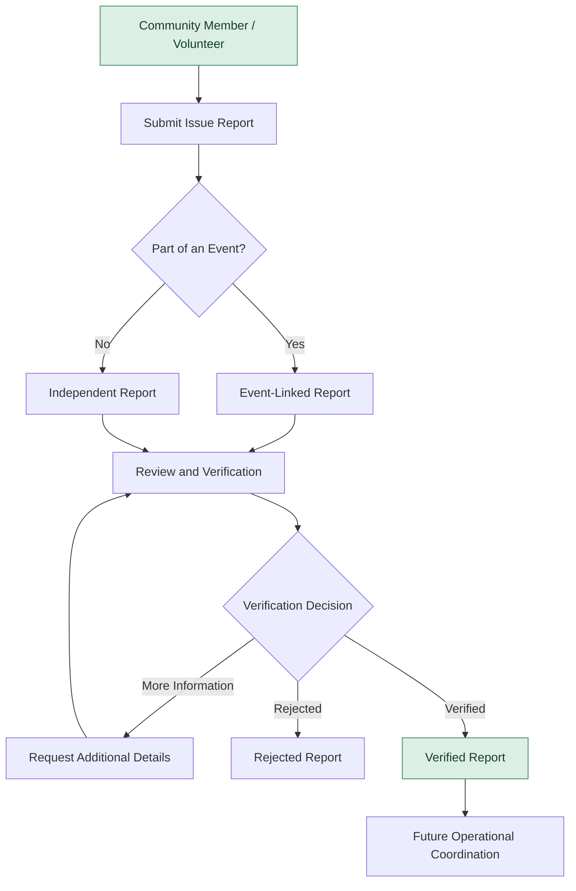
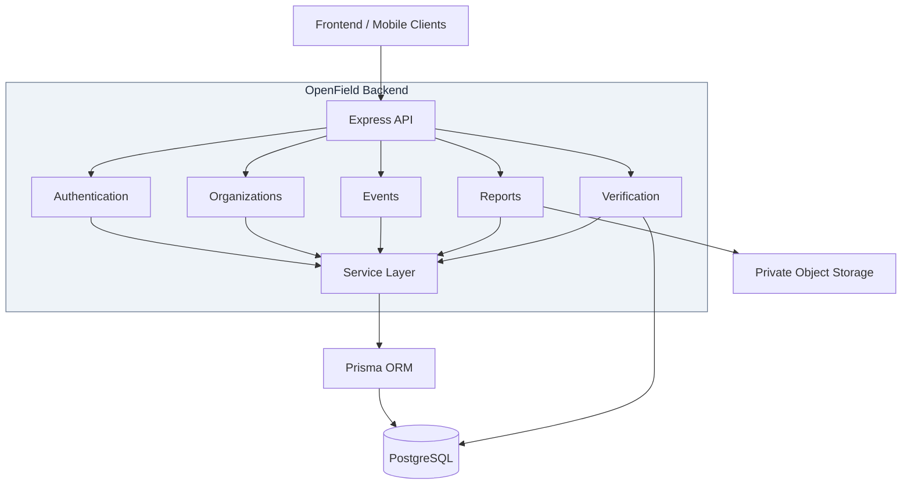

<div align="center">

# 🌱 OpenField

### Turning community-reported problems into coordinated action.

A collaborative field-intelligence platform connecting communities, NGOs, and volunteers to identify issues, share information, and coordinate meaningful real-world action.

<br/>


<br/>

**Built for collaboration. Designed for accountability.**

</div>

---

## 🌍 About OpenField

Across communities, countless issues need attention — damaged infrastructure, environmental concerns, inadequate public facilities, and gaps in social welfare.

While individuals and organizations often identify these problems, the information required to address them is scattered across disconnected platforms, messages, spreadsheets, and informal communication channels.

OpenField aims to bridge that gap.

It provides a structured platform where people can report real-world issues, organizations can collaborate around community initiatives, and authorized volunteers can participate in turning verified reports into action.

Rather than treating issue reporting as an isolated activity, OpenField is designed around the entire journey of a report — from initial submission and verification to coordination and eventual resolution.

## 🎯 What makes OpenField different?

- **Community-driven reporting:** Anyone permitted by the platform can bring an issue to attention.
- **Organization collaboration:** NGOs can coordinate through shared events and approved participation.
- **Structured verification:** Reports go through an explicit review process before being considered verified.
- **Geographical awareness:** Reports and organizational service areas provide context for local coordination.
- **Transparent history:** Important changes and verification decisions are designed to remain auditable.
- **Independent reporting:** Reports can exist independently or be associated with a larger community initiative.
- **Extensible architecture:** The platform is designed to support increasingly sophisticated operational workflows.

## ⚙️ How it works

OpenField brings together four important parts of community-driven action.

<details open>
<summary><strong>01 — Report</strong></summary>

A community member or volunteer identifies an issue and submits a report containing its description, location, category, and supporting evidence.

Reports can be submitted independently or as part of an existing event.

</details>

<details>
<summary><strong>02 — Organize</strong></summary>

Organizations can create community initiatives through events and invite other organizations to participate.

Participation is controlled through explicit approval by the hosting organization.

</details>

<details>
<summary><strong>03 — Verify</strong></summary>

Authorized reviewers examine submitted information, request additional details, identify potential duplicates, and make verification decisions.

Verification history is retained for accountability.

</details>

<details>
<summary><strong>04 — Coordinate</strong></summary>

Verified reports provide the foundation for organizations and volunteers to coordinate operational responses, collaborate, and track progress.

</details>

## 🗺️ Platform workflow



*This represents the intended product workflow; not every capability is currently implemented.*

## 🧩 Core platform capabilities

| Capability | Description |
|---|---|
| User Management | User registration and authentication |
| Organizations | Independent organizations with their own members and permissions |
| Teams | Internal organizational teams and membership |
| Category Taxonomy | Structured classification of community issues |
| Service Areas | Geographical areas supported by organizations |
| Events | Community initiatives hosted by organizations |
| Participation | Approval-based collaboration between organizations |
| Reports | Independent and event-linked issue reporting |
| Evidence Management | Secure storage references for supporting photographs and media |
| Verification | Structured report review and verification |
| Audit History | Traceable history of important report changes |

Some capabilities are part of the product design and are still under development.

## 🏗️ Architecture

OpenField follows a **Modular Monolith Architecture**.

The backend is organized around independent domain modules while sharing a single application runtime and relational database.

This approach keeps the system simple to develop and deploy while allowing individual domains to evolve without tightly coupling their business logic.



### Technology Stack

| Technology | Purpose |
|---|---|
| Node.js | Backend runtime |
| TypeScript | Type-safe application development |
| Express.js | REST API framework |
| PostgreSQL | Relational database |
| Neon | Managed PostgreSQL hosting |
| Prisma ORM | Database access and migrations |
| JWT | Authentication |
| Zod | Request validation |
| bcryptjs | Password hashing |

## 📁 Backend Structure

The backend follows a domain-oriented modular structure.

```text
backend/
│
├── prisma/
│   ├── schema.prisma
│   └── migrations/
│
├── src/
│   ├── config/
│   │
│   ├── lib/
│   │
│   ├── middleware/
│   │
│   ├── modules/
│   │   ├── auth/
│   │   ├── organizations/
│   │   ├── teams/
│   │   ├── categories/
│   │   ├── events/
│   │   ├── reports/
│   │   └── media/
│   │
│   ├── app.ts
│   └── server.ts
│
├── .env
├── package.json
└── tsconfig.json
```

*This illustrates the intended module organization; individual modules may still be under development.*

## 🚀 Getting Started

### Prerequisites

- Node.js
- npm
- PostgreSQL database
- Git

### 1. Clone the repository

```bash
git clone <YOUR_REPOSITORY_URL>
cd open-field/backend
```

### 2. Install dependencies

```bash
npm install
```

### 3. Configure environment variables

Create a `.env` file in the backend directory.

```env
PORT=5050

DATABASE_URL="YOUR_NEON_DATABASE_CONNECTION_STRING"

JWT_SECRET="YOUR_SECRET_KEY"
JWT_EXPIRES_IN="7d"
```

Generate a secure JWT secret:

```bash
openssl rand -base64 32
```

Never commit your `.env` file or expose database credentials.

### 4. Generate Prisma Client

```bash
npx prisma generate
```

### 5. Apply database migrations

For an existing development database, inspect the current migration history first.

Apply development migrations:

```bash
npx prisma migrate dev
```

For deployment environments:

```bash
npx prisma migrate deploy
```

Never reset a database containing data you need.

### 6. Start the development server

```bash
npm run dev
```

The development server currently runs on port `5050` by default.

## 🔌 API

The backend exposes versioned REST APIs under:

```text
/api/v1
```

### Authentication

| Method | Endpoint | Description |
|---|---|---|
| POST | `/api/v1/auth/register` | Register a new user |
| POST | `/api/v1/auth/login` | Authenticate an existing user |

### Register a User

```bash
curl -X POST http://localhost:5050/api/v1/auth/register \
  -H "Content-Type: application/json" \
  -d '{
    "name": "John Doe",
    "email": "john@example.com",
    "password": "strongpassword123"
  }'
```

### Login

```bash
curl -X POST http://localhost:5050/api/v1/auth/login \
  -H "Content-Type: application/json" \
  -d '{
    "email": "john@example.com",
    "password": "strongpassword123"
  }'
```

A successful login is intended to return a JWT that can be used to authenticate subsequent protected requests.

## 🔒 Security and Data Integrity

OpenField is being designed with security and data integrity as core requirements.

Key considerations include:

- Password hashing instead of plaintext storage.
- JWT-based authentication.
- Input validation using Zod.
- Organization and resource-level authorization.
- Database-level relational constraints.
- Transactional operations for multi-step workflows.
- Audit history for sensitive report changes.
- Private object storage for report evidence.
- Explicit state transitions for report verification.

Access to a resource must depend on actual membership and authorization relationships, not merely possession of its identifier.

## 🔭 What's Next?

OpenField is being developed towards a broader collaborative ecosystem.

Upcoming capabilities include:

- Advanced organization and team collaboration.
- Geographical organization discovery.
- Report claiming and assignment workflows.
- Assignment expiry and reassignment.
- Cross-organization operational collaboration.
- Realtime notifications.
- Offline-first synchronization.
- Advanced report similarity and duplicate analysis.
- Operational analytics.

The long-term goal is to make it easier for communities and organizations to move from identifying problems to coordinating meaningful solutions.

## 🤝 Contributing

Contributions, ideas, and discussions are welcome.

When contributing:

1. Keep changes aligned with the existing modular architecture.
2. Follow the established TypeScript conventions.
3. Preserve database integrity and authorization rules.
4. Add tests for new functionality.
5. Document significant architectural decisions.

For major feature proposals, open an issue describing the problem, proposed solution, and expected impact.

---

<div align="center">

### 🌱 OpenField

**Better coordination. Stronger communities. Meaningful action.**

<sub>Built with the belief that solving community problems starts with bringing the right people together.</sub>

</div>